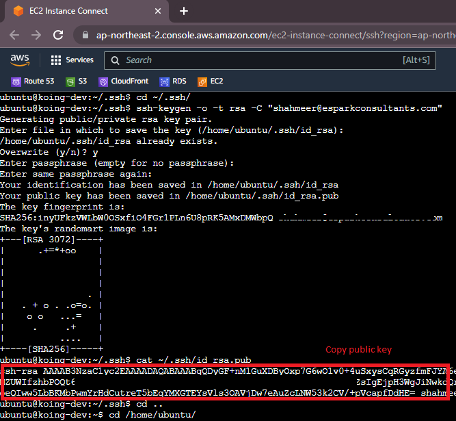
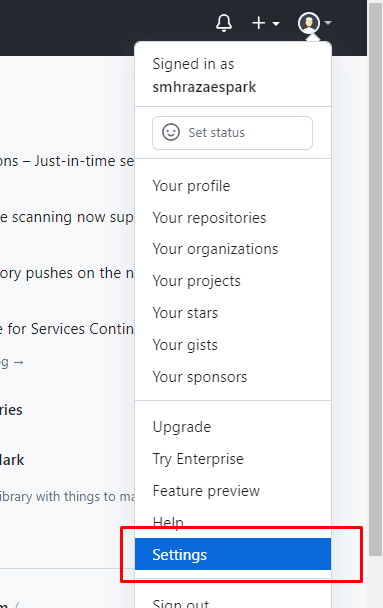
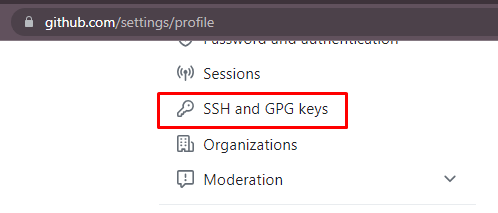
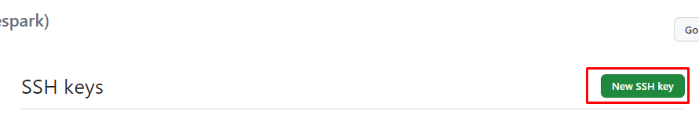
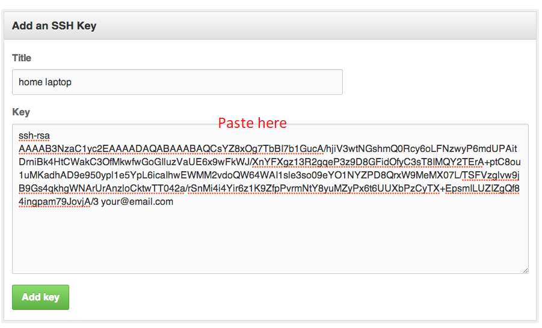
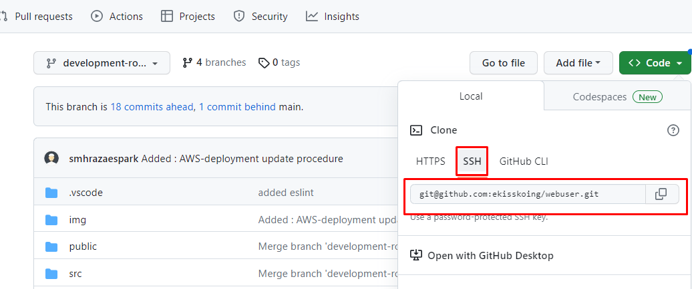
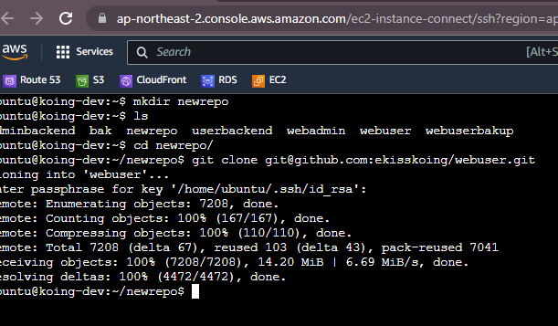

# How to add Github account in AWS-Linux
## Step 1: Log in to AWS console then generate ssh key
  - 
  - cd ~/.ssh/
  - ssh-keygen -o -t rsa -C "email@email.com"
  - cat ~/.ssh/id_rsa.pub
## Step 2: Log in to github via web-browser then locate the setting
  - 
  - 
  - 
  - 
## Step 3: Clone Required repo
  - 
  - Change/crete directory
  - 
- For more info 
https://jdblischak.github.io/2014-09-18-chicago/novice/git/05-sshkeys.html
