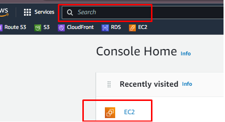
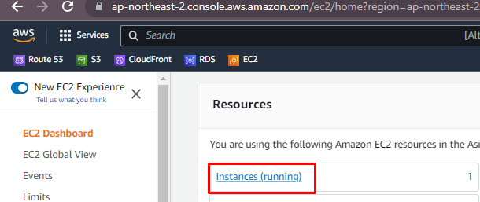
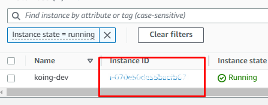
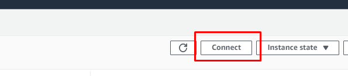
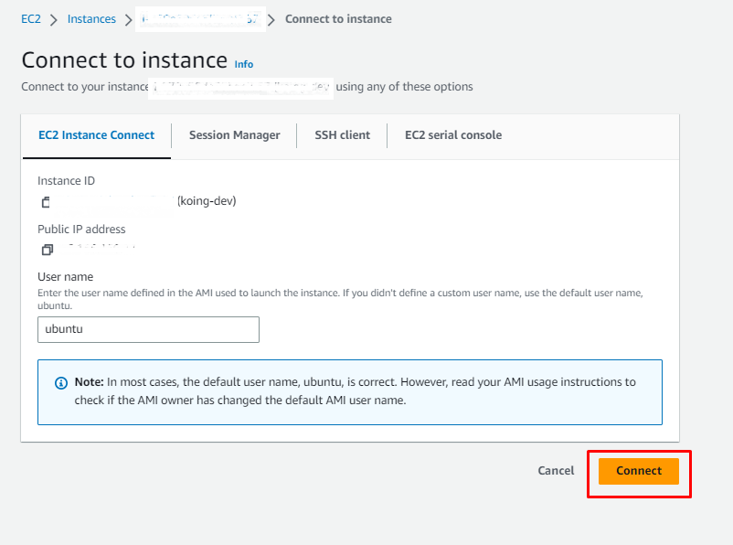
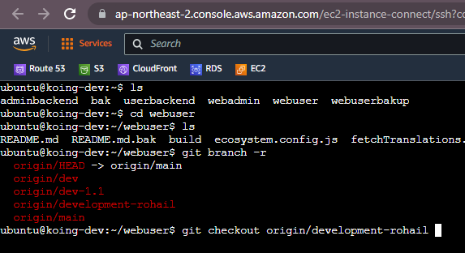
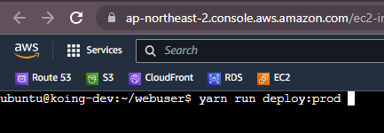
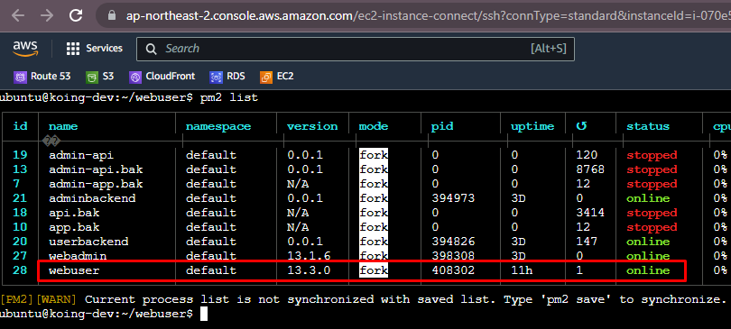

# How to udpate AWS-deployment
## Step 1: Log in to AWS console via web or ssh
  - https://console.aws.amazon.com/console/home?nc2=h_ct&src=header-signin
  - for user name password (contact admin) 
## Step 2: Access EC2 instance (for web only)
  - 
  - 
  - 
  - 
  - 
## Step 3: checkout latest branch
  - 
  - [how to add github account](#how-to-add-github-account-in-aws-linux)
## Step 4: Build and deploy 
  - 
  - yarn run deploy:prod
  - if any package like "passport" is not found, just add it using npm install command
  - 
## Result
https://dev.koing.ai/